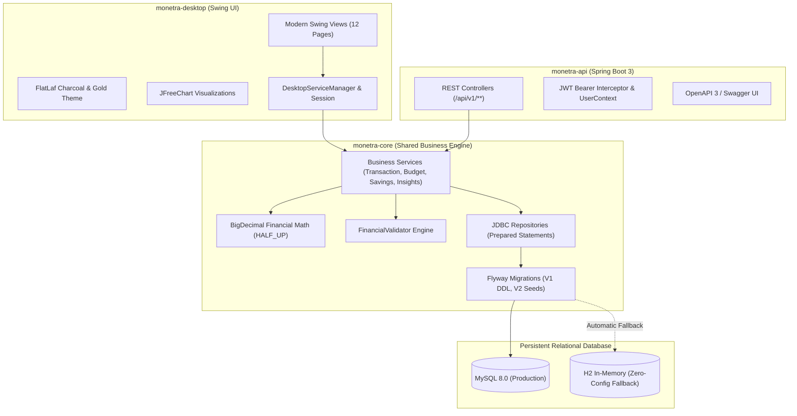
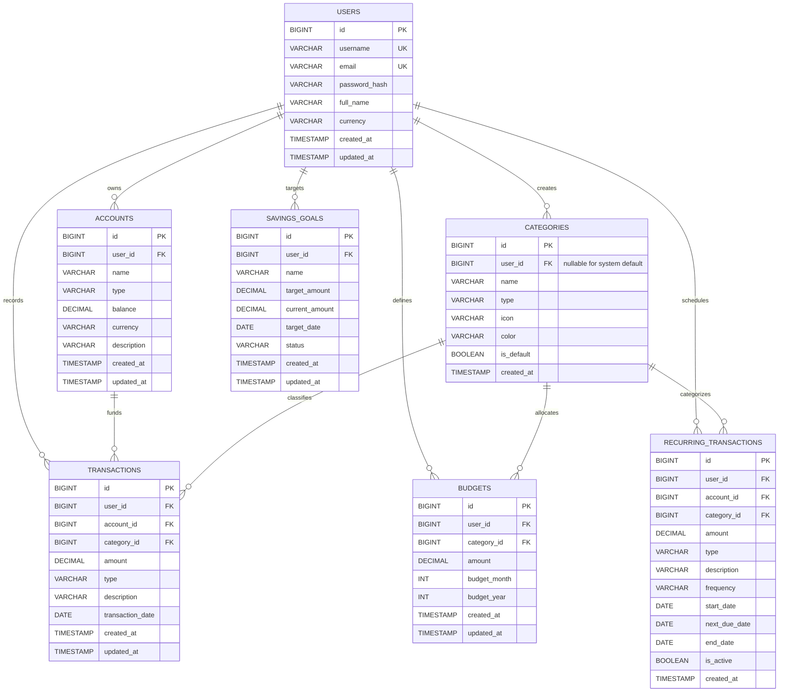

# MONETRA — Personal Finance Management System

[](https://openjdk.org/)
[](https://spring.io/projects/spring-boot)
[](https://flywaydb.org/)
[](https://www.formdev.com/flatlaf/)
[](https://www.jfree.org/jfreechart/)
[]()

> **MONETRA** is a complete, production-grade Java personal finance management application featuring a modular multi-module Maven architecture, secure REST API, and a Java Swing desktop interface. Both clients share the core business service layer and financial calculations with `BigDecimal` precision.

---

## 1. Architectural Overview

MONETRA is structured as a Maven multi-module system enforcing a strict separation of concerns:

```
MONETRA (Parent)
├── monetra-core        # Domain models, repositories, business services, calculations, Flyway migrations
├── monetra-api         # Spring Boot 3 REST API, OpenAPI/Swagger UI, JWT Bearer authentication, DTOs
└── monetra-desktop     # Java Swing desktop GUI, FlatLaf theme, JFreeChart visualizations, session management
```



### Module Responsibilities

1. **`monetra-core`**:
   - **Domain Models & Enums**: `User`, `Account`, `Category`, `Transaction`, `Budget`, `SavingsGoal`, `RecurringTransaction`, `AccountType`, `TransactionType`, `RecurrenceFrequency`, `BudgetStatus`, `GoalStatus`.
   - **Relational Persistence**: Spring JDBC repositories with prepared statements and parameter binding (`JdbcUserRepository`, `JdbcAccountRepository`, `JdbcTransactionRepository`, `JdbcBudgetRepository`, `JdbcSavingsGoalRepository`, `JdbcRecurringTransactionRepository`, `JdbcCategoryRepository`).
   - **Business Services**: `UserService`, `AccountService`, `CategoryService`, `TransactionService`, `BudgetService`, `SavingsGoalService`, `RecurringTransactionService`, `FinancialReportService`, `FinancialInsightService`, `SavingsCalculatorService`, `PasswordService`.
   - **Financial Calculations**: Strict `BigDecimal` arithmetic with `RoundingMode.HALF_UP` for all currency amounts, compound interest formulas, net worth, budget thresholds, and savings rates.
   - **Validation & Exceptions**: Input validators (`FinancialValidator`) and typed hierarchy (`MonetraException`, `ValidationException`, `ResourceNotFoundException`, `AuthenticationException`, `DuplicateResourceException`, `BudgetExceededException`, `UnauthorizedAccessException`).
   - **Flyway Database Migrations**: Version-controlled DDL schema (`V1__init_schema.sql`) and default category seed data (`V2__seed_default_categories.sql`).

2. **`monetra-api`**:
   - **Spring Boot 3 REST API**: Comprehensive controllers providing full CRUD for authentication, accounts, categories, transactions, budgets, savings goals, recurring rules, and reports.
   - **JWT Authentication & Authorization**: HMAC-SHA256 Bearer tokens, token expiration, ThreadLocal `UserContext`, and user data isolation across all endpoints.
   - **Global Exception Handling**: `@RestControllerAdvice` mapping domain exceptions to structured JSON responses (`ErrorResponse`).
   - **OpenAPI 3 / Swagger Documentation**: Interactive API explorer at `/swagger-ui.html`.

3. **`monetra-desktop`**:
   - **Modern Swing UI**: Polished charcoal (`#121214`) and warm gold (`#E5A93C`) visual identity built on FlatLaf Dark.
   - **12 Interactive Views**: Login, Registration, Dashboard, Transactions, Income, Expenses, Categories, Budgets, Savings Goals, Recurring Payments, Reports & Analytics, Settings.
   - **JFreeChart Visualizations**: Custom-styled bar charts, pie charts, and line graphs tied directly to database metrics.
   - **What-If Savings Calculator**: Interactive compounding goal calculator computing required monthly savings using `BigDecimal`.

---

## 2. Technology Stack

| Component | Technology | Version | Description |
| :--- | :--- | :--- | :--- |
| **Language** | Java (OpenJDK) | 17 LTS | Primary implementation language |
| **Build Tool** | Apache Maven | 3.9.9 | Multi-module dependency management & build |
| **Backend Framework** | Spring Boot | 3.2.5 | REST API framework, IoC container, Spring JDBC |
| **Database Migrations** | Flyway | 10.11.1 | Automatic version-controlled database schema migrations |
| **Database (Primary)** | MySQL Connector/J | 8.3.0 | Production relational database storage |
| **Database (Fallback)**| H2 Database | 2.2.224 | Embedded in-memory DB in MySQL compatibility mode |
| **Desktop Framework** | Java Swing | JDK 17 | Desktop GUI client |
| **UI Look & Feel** | FlatLaf Dark | 3.4.1 | Modern Dark Charcoal + Warm Gold theme |
| **Visualizations** | JFreeChart | 1.5.4 | Financial charting (Bar, Pie, Line charts) |
| **Password Security** | BCrypt (Spring Crypto)| 6.1.6 | Work factor 12 salt & hash for credentials |
| **API Documentation** | SpringDoc OpenAPI | 2.5.0 | Swagger UI and OpenAPI 3 schema definitions |
| **Testing** | JUnit 5 & AssertJ | 5.10.2 / 3.25.3 | Automated unit and integration testing suite |

---

## 3. Database Schema

The database is normalized to 3NF and enforces foreign key constraints with cascade rules and performance indexes.



### Pre-Seeded Default Categories (V2 Migration)
- **Income**: Salary, Freelancing, Other
- **Expense**: Food & Dining, Transportation, Shopping, Education, Entertainment, Healthcare, Housing, Utilities, Other

---

## 4. Getting Started & Setup

### Prerequisites
- **Java 17 or newer**: Verify with `java -version`.
- **Maven 3.8+**: Verify with `mvn -version`. (The project includes `.tools` wrapper scripts `mvnw.cmd` and `mvnw.ps1`).
- **MySQL 8.0+ (Optional)**: If MySQL is running on `localhost:3306`, the application connects automatically. If MySQL is not detected, MONETRA automatically boots embedded **H2 in MySQL compatibility mode**, requiring zero manual database setup.

### Environment Configuration
Copy the template configuration file:
```bash
cp .env.example .env
```
Default configuration values:
```env
DB_URL=jdbc:mysql://localhost:3306/monetra_db?createDatabaseIfNotExist=true&useSSL=false&allowPublicKeyRetrieval=true&serverTimezone=UTC
DB_USERNAME=root
DB_PASSWORD=root
JWT_SECRET=monetra_secure_finance_system_key_2026_super_secret_token_1234567890
SERVER_PORT=8080
```

---

## 5. Building & Running

### A. Compile and Run Automated Tests
Execute the full Maven test suite across all modules:
```powershell
.\mvnw.cmd test
```
*All 13 unit and integration tests will execute, validating financial calculations, budget thresholds, validator rules, service logic, repository operations, and REST API user data isolation.*

### B. Package All Modules
Build production-ready JAR archives:
```powershell
.\mvnw.cmd package -DskipTests
```
This generates:
- `monetra-api/target/monetra-api-1.0.0-SNAPSHOT.jar` (Executable Spring Boot REST Service)
- `monetra-desktop/target/monetra-desktop-1.0.0-SNAPSHOT.jar` (Executable Fat/Shaded Swing App)

### C. Run the Spring Boot REST API
Start the REST API service:
```powershell
.\mvnw.cmd spring-boot:run -pl monetra-api
```
*Or run directly via the packaged JAR:*
```powershell
.\.tools\jdk\bin\java.exe -jar monetra-api/target/monetra-api-1.0.0-SNAPSHOT.jar
```
- **API Base URL**: `http://localhost:8080/api/v1`
- **Interactive Swagger UI**: [http://localhost:8080/swagger-ui.html](http://localhost:8080/swagger-ui.html)
- **OpenAPI 3 JSON Spec**: `http://localhost:8080/v3/api-docs`

### D. Launch the Swing Desktop Application
Launch the desktop client:
```powershell
.\.tools\jdk\bin\java.exe -jar monetra-desktop/target/monetra-desktop-1.0.0-SNAPSHOT.jar
```
*Or via Maven:*
```powershell
.\mvnw.cmd exec:java -pl monetra-desktop -Dexec.mainClass="com.monetra.desktop.MonetraDesktopApp"
```

---

## 6. REST API Endpoints Overview

| Method | Endpoint | Description | Security |
| :--- | :--- | :--- | :--- |
| `POST` | `/api/v1/auth/register` | Register new user; auto-provisions Primary Checking account | Public |
| `POST` | `/api/v1/auth/login` | Authenticate and obtain JWT Bearer token | Public |
| `GET` | `/api/v1/auth/me` | Fetch authenticated user profile | Bearer Token |
| `GET` | `/api/v1/accounts` | List user accounts with balances | Bearer Token |
| `POST` | `/api/v1/accounts` | Create checking, savings, credit card, cash, or investment account | Bearer Token |
| `GET` | `/api/v1/accounts/{id}` | Get account details by ID | Bearer Token |
| `DELETE` | `/api/v1/accounts/{id}` | Delete account and associated transactions | Bearer Token |
| `GET` | `/api/v1/categories` | List categories (system defaults + user custom) | Bearer Token |
| `POST` | `/api/v1/categories` | Create custom category | Bearer Token |
| `GET` | `/api/v1/transactions` | Search & filter transactions (date range, type, category) | Bearer Token |
| `POST` | `/api/v1/transactions` | Create income/expense with atomic balance update | Bearer Token |
| `PUT` | `/api/v1/transactions/{id}` | Edit transaction amount/category/account | Bearer Token |
| `DELETE` | `/api/v1/transactions/{id}` | Revert account balance adjustment and delete transaction | Bearer Token |
| `GET` | `/api/v1/budgets` | List budgets with spent amounts, remaining, and alert statuses | Bearer Token |
| `POST` | `/api/v1/budgets` | Set category monthly budget limit | Bearer Token |
| `GET` | `/api/v1/savings-goals` | List savings goals with progress percentages | Bearer Token |
| `POST` | `/api/v1/savings-goals` | Create savings goal with target date and target amount | Bearer Token |
| `POST` | `/api/v1/savings-goals/{id}/contribute`| Deposit funds into goal from designated source account | Bearer Token |
| `GET` | `/api/v1/recurring` | List scheduled recurring payments | Bearer Token |
| `POST` | `/api/v1/recurring` | Schedule weekly, monthly, or yearly recurring payment | Bearer Token |
| `POST` | `/api/v1/recurring/process-due` | Execute due recurring transactions without duplicates | Bearer Token |
| `GET` | `/api/v1/reports/summary` | Full dashboard summary (balances, income, expense, insights) | Bearer Token |
| `GET` | `/api/v1/reports/category-spending` | Category breakdown for pie chart | Bearer Token |
| `GET` | `/api/v1/reports/monthly-trends` | Monthly income/expense/net trends for bar chart | Bearer Token |
| `GET` | `/api/v1/reports/insights` | Rule-based financial intelligence derived from actual records | Bearer Token |
| `POST` | `/api/v1/reports/what-if-calculator` | Future value compounding savings calculator | Bearer Token |

---

## 7. Financial Intelligence & What-If Calculator

MONETRA uses a rule-based intelligence engine derived strictly from stored database records without relying on external third-party AI APIs:

1. **Month-over-Month Comparison**: Calculates spending velocity compared to the previous calendar month.
2. **Top Expense Driver**: Analyzes categorized expenses to pinpoint the highest expenditure sector.
3. **Savings Ratio Benchmark**: Evaluates total monthly income against expenses, warning if the savings rate falls below 20%.
4. **Budget Consumption Warnings**:
   - `OK`: Usage below 80%.
   - `WARNING`: Usage between 80% and 100%.
   - `EXCEEDED`: Over-budget alerts displaying the exact overrun amount.
5. **What-If Future Value Calculator**: Calculates the exact monthly savings deposit required to achieve a target sum over $N$ months at an expected annual interest rate $r$ using the annuity formula with `BigDecimal` precision:
   $$\text{Monthly Deposit} = \frac{\text{Target} \times i}{(1 + i)^n - 1}$$
   where $i = \frac{r}{12 \times 100}$.

---

## 8. Verification & Test Suite

The automated test suite covers all financial logic, validators, persistence, and REST API contracts:

```
[INFO] -------------------------------------------------------
[INFO]  T E S T S
[INFO] -------------------------------------------------------
[INFO] Running com.monetra.core.BudgetThresholdTest
[INFO] Tests run: 3, Failures: 0, Errors: 0, Skipped: 0
[INFO] Running com.monetra.core.FinancialCalculationTest
[INFO] Tests run: 4, Failures: 0, Errors: 0, Skipped: 0
[INFO] Running com.monetra.core.FinancialValidatorTest
[INFO] Tests run: 4, Failures: 0, Errors: 0, Skipped: 0
[INFO] Running com.monetra.core.RepositoryAndServiceIntegrationTest
[INFO] Tests run: 1, Failures: 0, Errors: 0, Skipped: 0
[INFO] Running com.monetra.api.MonetraApiIntegrationTest
[INFO] Tests run: 1, Failures: 0, Errors: 0, Skipped: 0
[INFO] 
[INFO] Results:
[INFO] Tests run: 13, Failures: 0, Errors: 0, Skipped: 0
[INFO] -------------------------------------------------------
[INFO] BUILD SUCCESS
```

---

## 9. Security & Data Integrity

- **Password Hashing**: BCrypt hashing with work factor 12. Plaintext passwords are never stored or logged.
- **Strict Data Isolation**: Every database query filters by `user_id`. Users cannot view or modify transactions, accounts, budgets, or goals belonging to another user.
- **Decimal Precision**: Monetary values use `DECIMAL(14,2)` in SQL and `BigDecimal` in Java with explicit rounding to prevent binary floating-point representation errors.
- **SQL Injection Prevention**: All database operations use JDBC parameterized queries via Spring `JdbcTemplate`.
- **Atomic Balance Updates**: Account balances are updated within database transactions when transactions are created, edited, or deleted.

